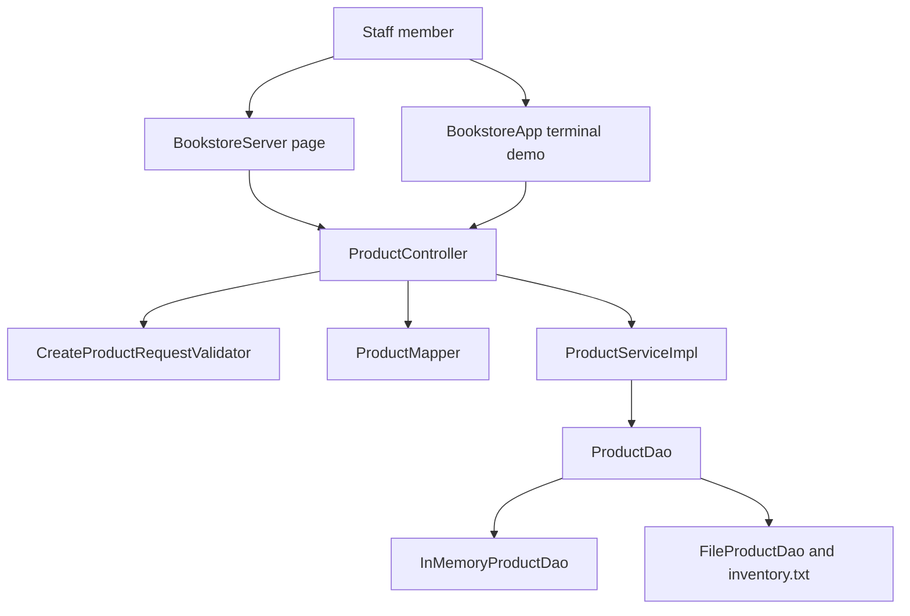

# Campus Bookstore Inventory

A Java inventory system for a campus bookstore. Staff can add books, look them up, see the whole catalog, restock copies, record a purchase, and remove a title. I built it for my software engineering class, then kept going until I could use it in a browser instead of only in a terminal.

## What my professor asked for

The assignment was a layered Java application, worth 40% of the course grade. No web framework was required. A `main` method that prints results was enough.

The bookstore had to support six actions:

| Action | Required behavior |
| --- | --- |
| Create | Save a new product and reject a SKU that already exists |
| Get | Return the product, or fail if that SKU does not exist |
| List | Return every product, or an empty list |
| Restock | Increase the quantity and return the updated product |
| Purchase | Decrease the quantity, and reject a sale larger than the stock |
| Delete | Return true when a product was removed, and false when it was not found |

Reading a product must not change its quantity. A notebook with 10 copies stays at 10 when someone looks it up. Buying 3 leaves 7. Trying to buy 8 after that must fail and leave the quantity at 7.

SKUs and names cannot be blank. Price has to be greater than zero. A new product cannot start with a negative quantity. Restock and purchase amounts have to be greater than zero. A rejected action must not change what is stored.

The design had to follow the layers we practiced in class:

- A `Product` model
- A `ProductDao` that hides the storage
- A `ProductService` that owns the rules and receives the DAO through its constructor
- A `CreateProductRequest` that is converted into a `Product` before the service sees it
- A `ProductController` whose methods return a readable sentence

I also took on two extra-credit pieces. `FileProductDao` stores the inventory in `data/inventory.txt`, and the service can switch to `InMemoryProductDao` by changing one constructor call. `CreateProductRequestValidator` checks the form before the controller calls the service.

## How the design fits together



The controller does not calculate stock, and it never opens the file or the map. The service decides whether an action is allowed. The DAO only stores and retrieves products.

I kept a `HashMap` for the in-memory DAO because every lookup in this assignment is by SKU. `save` inserts a new SKU or replaces the product that already has that SKU. `findBySku`, `findAll`, and `deleteBySku` match the interface directly. Both DAOs return copies, so looking at a product cannot change the copy that is stored.

`FileProductDao` writes one product per line:

```text
NB-1|Notebook|4.5|10
```

Closing the program no longer throws the inventory away. The next run reads the file back.

## Design process

I treated the Figma file as the picture and the Java server as the product. The prototype showed me the layout I wanted: a header, a summary of titles, copies, and inventory value, the catalog, an add form, and four action cards. I did not add a second application. I translated that layout into the HTML returned by `BookstoreServer`, and every button still posts to `ProductController`.

That was the step past the assignment. The required demo is still `BookstoreApp`, which prints the notebook story in the terminal. The server is there because I wanted to use the inventory the way a staff member would, and because I wanted the project to feel like something I could keep extending.

## Checkpoints

I pushed the project as I finished each layer so the history shows the build, not one giant upload at the end.

1. `Product` and the `ProductDao` interface.
2. Both DAOs, the service rules, the request, the mapper, and the validator.
3. The controller and the terminal demonstration. I ran the notebook scenario and checked that a rejected purchase left the quantity at 7.
4. A small local server so the same controller could be used from a browser.
5. The Figma design applied to that server, with the same create, lookup, restock, purchase, and delete actions.

## How I used AI tools

I used Cursor to move faster through the setup, the boilerplate, and the translation from my Figma layout into the Java page. I did not accept a change just because it compiled. Before keeping a class, I read it against the assignment: who is allowed to change the quantity, what happens when the SKU is missing, and whether a failed purchase calls `save`. The names, the package layout, and the decision to keep the browser UI on top of the existing controller were mine. The tool shortened the typing. The review is what made the project mine.

## Run the project

The terminal demonstration:

```bash
mvn -q compile exec:java -Dexec.mainClass=app.BookstoreApp
```

The browser, which I use when I want to work with the inventory directly:

```bash
mvn -q compile exec:java -Dexec.mainClass=app.BookstoreServer
```

Then open [http://localhost:8080](http://localhost:8080). Leave that terminal running, and press Control+C when you are done. The page stores products in `data/inventory.txt`.

To switch the terminal demo to the in-memory map, change the DAO line in `BookstoreApp` to `new InMemoryProductDao()`. The service and the controller stay the same.

## What I want to build next

The class version is complete, and I am not done with the idea. Next I want JUnit tests around the service, with a mock DAO that proves a rejected purchase never calls `save`. I also want the datastore, DAO, and service exceptions from the extra credit, so a full file or a failed write becomes a message the page can show. After that, the same `ProductDao` interface could sit in front of a real database without rewriting the service or the screen.
